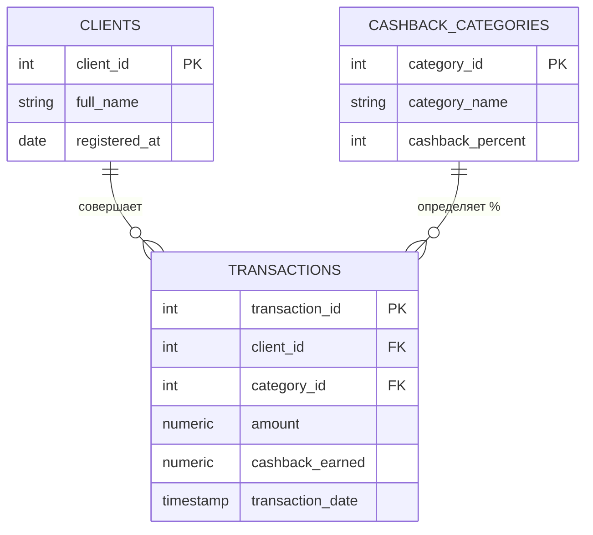

# CASH (Cashback Analytics & Service Hub)

Учебный проект по проектированию сервиса повышенного кешбэка и аналитике транзакций. Реализован как пет-проект на стыке системного анализа и SQL-аналитики.

## Что реализовано

1. **База данных (`src/database/`)**
   Спроектирована реляционная схема из трёх связанных таблиц (`clients`, `cashback_categories`, `transactions`) с первичными и внешними ключами. Написан скрипт инициализации БД на SQLite и генератор тестовых данных (50 клиентов и 1500 операций).

2. **REST API (`src/api.py`)**
   Небольшой сервис на FastAPI с одним рабочим эндпоинтом `POST /api/v1/cashback/calculate`. Принимает ID клиента, категорию и сумму покупки, проверяет их наличие в базе и возвращает рассчитанный процент и сумму кешбэка.

3. **SQL-аналитика и визуализация (`src/analytics/`, `src/dashboard.py`)**
   Набор SQL-запросов для расчёта продуктовых метрик (средний чек, доля выплат кешбэка по категориям, сегментация клиентов и ранжирование операций через оконные функции) плюс простой дашборд на Streamlit для просмотра графиков.

---

## Схема базы данных



---

## Описание API

### `POST /api/v1/cashback/calculate`
Расчёт суммы кешбэка при покупке.

**Пример запроса:**
```json
{
  "client_id": 1,
  "category_id": 2,
  "amount": 2500.00
}
```

**Пример ответа (200 OK):**
```json
{
  "status": "APPROVED",
  "client_name": "Иванов И.И.",
  "category_name": "Рестораны и кафе",
  "cashback_percent": 5,
  "cashback_amount": 125.0
}
```
Если `client_id` или `category_id` не найдены в базе, сервис возвращает `404 Not Found`.

---

## Структура проекта

```text
CASH/
├── .gitignore
├── requirements.txt
├── README.md
└── src/
    ├── database/
    │   ├── schema.sql          # DDL-скрипт создания таблиц
    │   ├── init_db.py          # Создание локальной БД cash.db
    │   └── seed_generator.py   # Генерация тестовых клиентов и транзакций
    ├── analytics/
    │   └── queries.sql         # SQL-запросы (JOIN, агрегации, оконные функции)
    ├── api.py                  # Сервис на FastAPI
    └── dashboard.py            # Дашборд на Streamlit
```

---

## Как запустить локально

1. Установить библиотеки:
   ```bash
   pip install -r requirements.txt
   ```

2. Создать базу и наполнить её тестовыми данными:
   ```bash
   python src/database/init_db.py
   python src/database/seed_generator.py
   ```

3. Запустить API (документация Swagger будет доступна по адресу `http://127.0.0.1:8000/docs`):
   ```bash
   uvicorn src.api:app --reload
   ```

4. Запустить дашборд:
   ```bash
   streamlit run src/dashboard.py
   ```